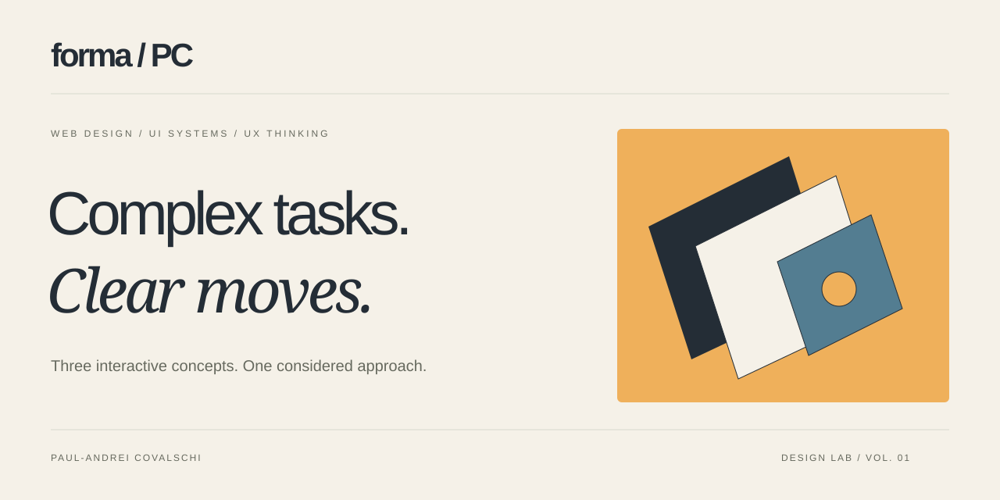

# FORMA — Design that makes sense.

An interactive web and UX/UI design showcase by **Paul-Andrei Covalschi**, built with AI assistance. Three self-initiated concepts explore how visual hierarchy, thoughtful interaction, and accessible controls can make complex tasks easier.

**[Explore the live demo](https://covalschipaul.github.io/forma-design-lab/)** · [UX case studies](docs/case-studies.md) · [Design system](docs/design-system.md) · [QA checklist](docs/qa.md)



## Explore the work

| Concept | Design focus | Working interactions |
| --- | --- | --- |
| **Clear** — catalog workspace | Information hierarchy and operational UX | Search, status filters, mark reviewed, undo, reset, empty results |
| **Still** — everyday objects | Product presentation and purchasing clarity | Finish selection, quantity, subtotal, simulated bag, empty bag |
| **Offgrid** — small discoveries | Editorial design and discovery | Interest filters, save/unsave, shortlist, clear saved, empty states |

The page also includes project filters, individual case studies, a visual token board, and responsive layouts.

## Run locally

No installation or API key is required. Open `index.html` in a current browser, or serve the folder:

```sh
python -m http.server 8000
```

Then visit `http://localhost:8000`. There is no build step.

## Design intent

- **A distinct visual language:** warm paper, dark ink, acid green, large typography, and editorial spacing.
- **A real task behind every screen:** review an exception, configure a purchase, or shortlist a place.
- **Visible feedback:** state changes are announced; reversible actions stay available.
- **Accessible foundations:** semantic landmarks, labels, native controls, modal dialogs, keyboard focus styles, reduced-motion support, and text-based status indicators.
- **Small footprint:** plain HTML/CSS/JavaScript, system fonts, original CSS/SVG artwork, no third-party runtime dependencies or tracking.

## Project structure

```text
index.html              Main showcase and preview artwork
styles.css              Design tokens, responsive layouts, demo styling
app.js                  Filters, dialogs, and three interactive prototypes
docs/case-studies.md    Problems, hypotheses, decisions, validation plans
docs/design-system.md   Visual language and interaction rules
docs/qa.md              Manual verification checklist and known limits
docs/cover.svg          Original repository cover
```

## Honesty about scope

This is a portfolio exercise, not commissioned client work. All brands, products, places, and metrics in the demos are illustrative. There are no claimed interviews, usability results, revenue improvements, or conversion lifts. The case studies distinguish assumptions from proposed validation.

Prototype state stays in memory and resets on reload. There is no backend, payment flow, inventory integration, production catalog correction, account, or map service. “Mark reviewed” simulates review status only; it does not repair the underlying issue. The static dashboard preview is an illustrative visual composition, separate from the five-row interactive queue.

## Next iterations

1. Run the task-based sessions described in the case studies and record observed failures.
2. Validate with assistive technology and a broader device/browser matrix.
3. Replace product illustrations with verified product photography for a real commerce use case.
4. Connect one concept to a real backend only after validating its core flow.

## Attribution and license

Concept direction and portfolio: Paul-Andrei Covalschi. Implementation and initial design exploration created with AI assistance. All artwork is original CSS/SVG; no external image licenses are required. Code is available under the [MIT License](LICENSE).
